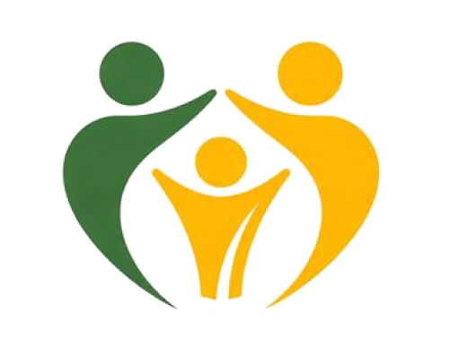
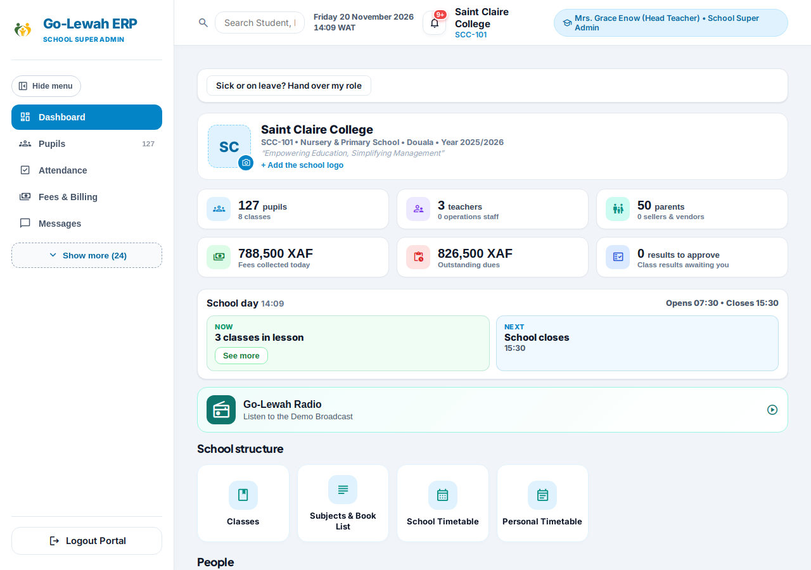
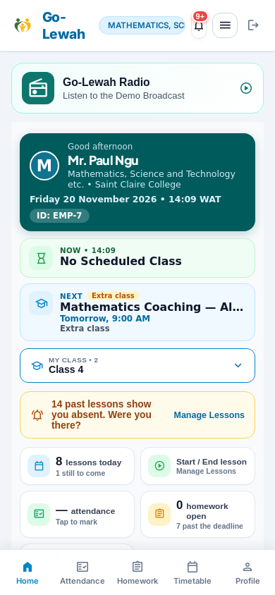
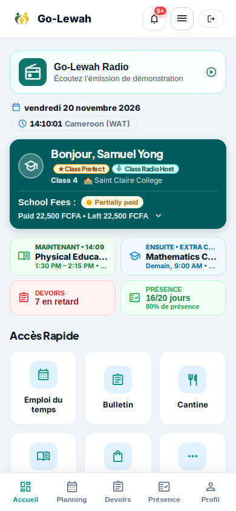
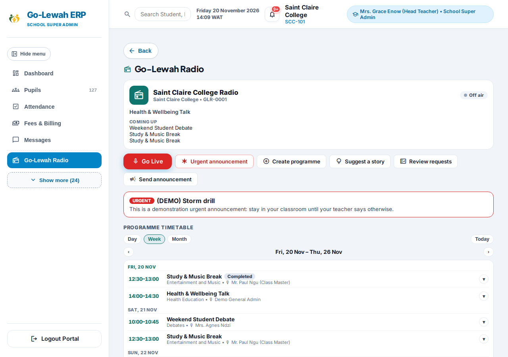
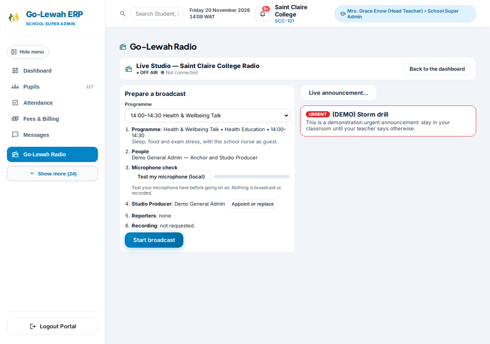
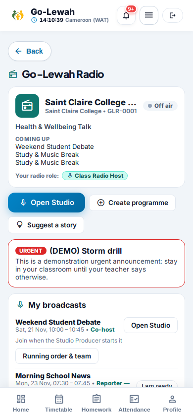
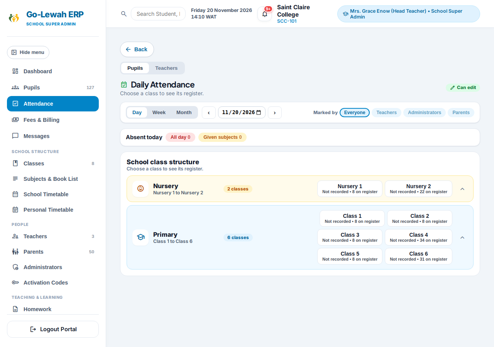
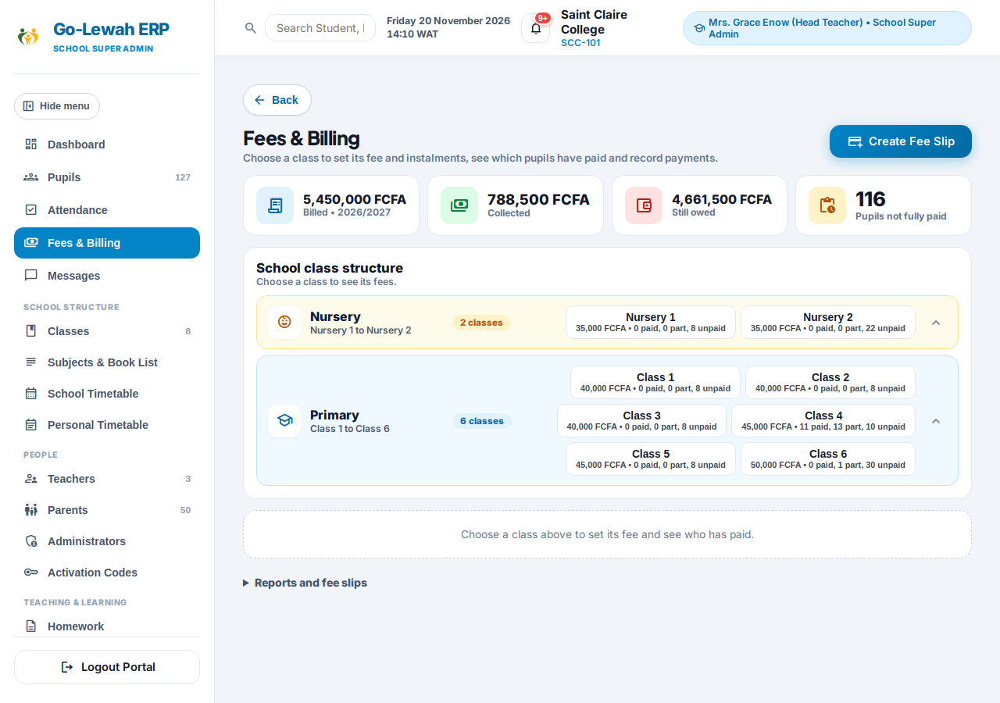

# Go-Lewah — School Management Platform (Product Showcase)

**Collins Nji** — Founder | AI-Assisted Product Development & Technical Documentation Lead · Go-Lewah Educational Platform

> **This repository is a showcase, not the application.** It contains a product overview, screenshots made with
> synthetic demonstration accounts, a high-level architecture overview and documentation samples. The application's
> source code, data and infrastructure are private.

**Go-Lewah** is a bilingual (English / French) school management platform designed for schools in Cameroon. It
brings school administrators, teachers, students, parents and approved school vendors onto one platform, on
desktop and mobile. It covers daily school operations: classes and timetables, attendance, homework, exams and
report cards, fees, the school canteen, messages and notifications. It also adds community features, such as a
used-books exchange and **Go-Lewah Radio**, a moderated school radio station with live broadcasting.

| School administrator (desktop) | Teacher (mobile) | Student (mobile, French) |
|---|---|---|
|  |  |  |

---

## Why Go-Lewah

Many schools still run on paper registers, spreadsheets and phone calls. Parents learn about absences, fees and
results late, and teachers repeat the same administrative work every day. Go-Lewah aims to:

- give each school one place for its structure, people, timetable, attendance, results and fees;
- keep parents informed in their own language, without exposing other children's information;
- respect the Cameroonian school system (nursery, primary and secondary streams, official report-card formats,
  FCFA fees, Cameroon time);
- add safe, moderated community features — a school radio and a used-books exchange — with child protection and
  parental consent built in from the start.

## Major features

**School operations**
- School set-up: classes, streams, subjects and book lists, school and personal timetables, administrators with
  distinct roles (e.g. secretary, bursar) and an audit history of changes.
- Attendance for pupils and teachers (day / week / month), absence notes, lesson sessions and registers.
- Homework, exams and results with a two-step **approve → publish** workflow, and report cards in the official
  Cameroonian format.
- Fees and billing: class fees, instalments, fee slips, payments and outstanding balances (FCFA).
- Canteen meals, extra and holiday classes, school events and celebrations.

**People and communication**
- Role-based portals for school administrators, teachers, students, parents and vendors, with mobile layouts.
- In-app messages and notifications in **English and French**.
- Consent screens and per-child permissions managed by parents.

**Community**
- Used-books exchange and school marketplace for approved vendors.
- **Go-Lewah Radio**: each school can switch on its own radio station. Programmes are requested, reviewed and
  approved; programmes can repeat; a shared **Live Studio** has role-based controls. The roles are Programme
  Anchor, Studio Producer, co-hosts, reporters and approved speakers. Moderators can pause, mute or remove
  speakers. Student participation requires recorded parental consent. Live school announcements are supported, and
  every action is logged.

**Platform administration**
- Platform (HQ) administration of school applications, support and an append-only audit trail.

| Go-Lewah Radio dashboard | Live Studio — preparing a broadcast | Radio on a student's phone |
|---|---|---|
|  |  |  |

| Daily attendance | Fees and billing |
|---|---|
|  |  |

---

## My role

**Collins Nji — Founder | AI-Assisted Product Development & Technical Documentation Lead.** I bring more than eight
years in technical communication, structured documentation, content operations and technical support. I also hold
an M.A. in Technical Communication and eLearning from the University of Limerick, Ireland.

- Conceived Go-Lewah and defined its product vision and requirements.
- Designed the information architecture, user roles, permission models and functional workflows.
- Produced detailed specifications for school administration, academic management, the marketplace and Radio.
- Directed AI-assisted development workflows using Claude and other development tools.
- Reviewed implementation results, identified defects and coordinated iterative improvements.
- Oversaw documentation, usability, bilingual English/French requirements and quality assurance.
- Managed development priorities and GitHub workflows.

Go-Lewah applies technical-communication skills to product development: AI-assisted technical communication,
information architecture, structured content, workflow automation and product documentation. See
[docs/MY-ROLE.md](docs/MY-ROLE.md) for details.

## Technology (high level)

React single-page application (desktop and mobile layouts) · Node.js / Express REST API · SQLite · WebRTC live
audio through a LiveKit media server · role-based access control · English/French throughout.

See [docs/ARCHITECTURE.md](docs/ARCHITECTURE.md) for the architecture diagram.

## Project status

Go-Lewah is **in active development and has not launched publicly yet**. See
[docs/FEATURE-STATUS.md](docs/FEATURE-STATUS.md) for what is implemented and what is still in progress.

## Documentation samples

- [Go-Lewah Radio — roles and permissions in the Live Studio](docs/samples/radio-live-studio-permissions.md)
- [Testing approach](docs/samples/testing-approach.md)

---

*All screenshots use a synthetic demonstration school ("Saint Claire College") and fictitious people. No real
pupils, parents, staff or schools appear in this repository.*

© Go-Lewah. All rights reserved. This showcase is shared for portfolio purposes only; no licence to the Go-Lewah
software is granted.
