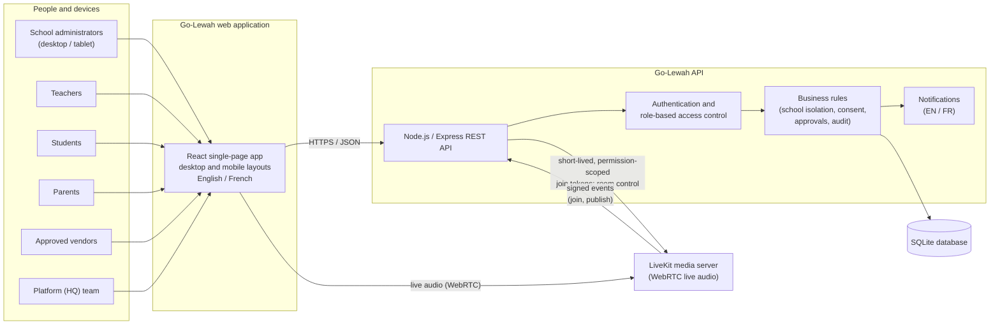

# Architecture (high level)

This page describes Go-Lewah's architecture at a conceptual level only. It deliberately omits hosting providers,
server names, addresses, ports, file locations and configuration.

## Key design principles

- **The server decides.** Every permission is checked by the API; the app only shows or hides controls.
  Broadcasting rights are enforced by the media server itself. For example, a muted speaker's right to publish
  audio is withdrawn there, not just shown as muted in the app.
- **School isolation.** Each school sees only its own people, programmes and records.
- **Least privilege and expiry.** Radio roles belong to one programme and end with it. Join tokens are short-lived,
  and administrators delegate duties one by one.
- **Child protection.** A student can only speak on the radio with recorded parental permission. Vendors never hear
  student voices or names.
- **Accountability.** Significant actions are written to an append-only audit history.
- **Bilingual by design.** Screens, notifications and server messages are available in English and French.
- **Safe environments.** Development uses synthetic data and separate test databases. Production changes need
  separate approval.
